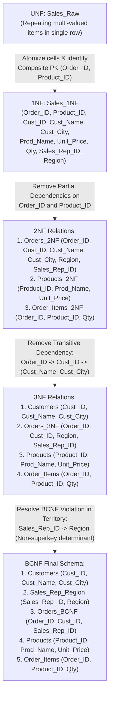

# Experiment 7: Step-by-Step Normalization (UNF to BCNF) & Lossless Join Verification

> **Student Name**: Arush Gupta  
> **UID**: 25LBCS3097  
> **Course**: DBMS Laboratory (MySQL 8.0+)

## 📌 Problem Statement
Given a denormalized `Sales` table, identify functional dependencies and normalize step-by-step from `UNF` to `3NF` and `BCNF`. Verify lossless join and dependency preservation using SQL queries.

---

## 1. Aim
To identify functional dependencies (FDs) in a denormalized `Sales_Raw` relation, decompose it step-by-step through `1NF`, `2NF`, `3NF`, and `BCNF`, and verify the **lossless-join property** (zero spurious tuples) and **dependency preservation** using MySQL queries.

---

## 2. Objectives
1. Analyze a denormalized `Sales_Raw` table containing repeating groups, partial dependencies, transitive dependencies, and an overlapping candidate-key determinant anomaly.
2. Formulate all functional dependencies and normalize sequentially (`UNF` $\rightarrow$ `1NF` $\rightarrow$ `2NF` $\rightarrow$ `3NF` $\rightarrow$ `BCNF`).
3. Verify lossless decomposition via natural joins and check functional dependency preservation with `GROUP BY ... HAVING COUNT(DISTINCT ...) > 1`.

---

## 3. Normalization Progression Diagram



---

## 4. Functional Dependencies & Step-by-Step Normalization

Given the atomic attributes in `Sales_1NF(Order_ID, Product_ID, Cust_ID, Cust_Name, Cust_City, Prod_Name, Unit_Price, Qty, Sales_Rep_ID, Region)`:
- **Functional Dependencies ($\mathcal{F}$):**
  - $FD_1$: $\{\text{Order\_ID}, \text{Product\_ID}\} \rightarrow \text{Qty}$ *(Full dependency on composite PK)*
  - $FD_2$: $\text{Order\_ID} \rightarrow \{\text{Cust\_ID}, \text{Sales\_Rep\_ID}, \text{Region}\}$ *(Partial dependency on `Order_ID`)*
  - $FD_3$: $\text{Product\_ID} \rightarrow \{\text{Prod\_Name}, \text{Unit\_Price}\}$ *(Partial dependency on `Product_ID`)*
  - $FD_4$: $\text{Cust\_ID} \rightarrow \{\text{Cust\_Name}, \text{Cust\_City}\}$ *(Transitive dependency via `Order_ID`)*
  - $FD_5$: $\text{Sales\_Rep\_ID} \rightarrow \text{Region}$ *(Each sales rep operates in a single fixed region; violates BCNF when determinant is not a superkey)*

---

## 5. Execution Instructions

### Using MySQL Command-Line Client:
```bash
mysql -u root -p < EXPERIMENT_07/experiment_07.sql
```

### Using MySQL Workbench:
1. Open MySQL Workbench.
2. Open `EXPERIMENT_07/experiment_07.sql`.
3. Press `Ctrl+Shift+Enter` to execute.

---

## 6. Output & Verification Summary

### Step-by-Step Normal Form Summary

| Normal Form | Anomaly Eliminated | Resulting Relations |
| :--- | :--- | :--- |
| **1NF** | Eliminates repeating item groups per order | `Sales_1NF(Order_ID, Product_ID, Cust_ID, Cust_Name, Cust_City, Prod_Name, Unit_Price, Qty, Sales_Rep_ID, Region)` |
| **2NF** | Eliminates partial dependencies ($FD_2, FD_3$) on parts of composite key `(Order_ID, Product_ID)` | `Orders_2NF`, `Products`, `Order_Items` |
| **3NF** | Eliminates transitive dependency $\text{Order\_ID} \rightarrow \text{Cust\_ID} \rightarrow \{\text{Cust\_Name}, \text{Cust\_City}\}$ ($FD_4$) | `Customers`, `Orders_3NF`, `Products`, `Order_Items` |
| **BCNF** | Eliminates determinant $\text{Sales\_Rep\_ID} \rightarrow \text{Region}$ ($FD_5$) where determinant is not a superkey | `Customers`, `Sales_Rep_Region`, `Orders_BCNF`, `Products`, `Order_Items` |

### Lossless Join & Dependency Preservation Output

| Verification Metric | Original `Sales_1NF` | Reconstructed BCNF Join | Status |
| :--- | ---: | ---: | :--- |
| **Total Tuple Count** | `4` rows | `4` rows | **Lossless Join Confirmed** (`0` spurious tuples) |
| **Symmetric Tuple Difference** | `0` mismatched rows | `0` mismatched rows | **Exact Reconstruction Verified** |
| **FD Violation Count (`HAVING COUNT(DISTINCT ...) > 1`)** | — | `0` rows returned | **All FDs ($FD_1 \dots FD_5$) Enforced via Primary Keys** |
