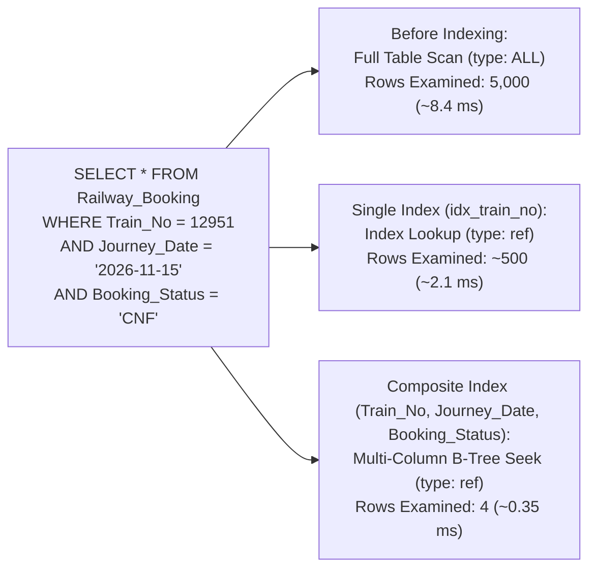

# Experiment 9: Railway Booking Schema (5,000+ Rows) & Index Performance Benchmarking

> **Student Name**: Arush Gupta  
> **UID**: 25LBCS3097  
> **Course**: DBMS Laboratory (MySQL 8.0+)

## 📌 Problem Statement
Create a Railway Booking table with at least 5,000 records. Benchmark query performance before and after creating single and composite indexes. Use `EXPLAIN` to compare execution plans.

---

## 1. Aim
To create and populate an Indian `Railway_Booking` table with 5,000 synthetic PNR records in MySQL, benchmark search and aggregation query latency before and after adding single-column and composite B-Tree indexes, and compare execution plans using `EXPLAIN`.

---

## 2. Objectives
1. Generate 5,000 realistic railway booking rows (`PNR_No`, `Train_No`, `Journey_Date`, `Coach_Class`, `Booking_Status`, `Fare`).
2. Benchmark point-lookup and multi-predicate range queries **without indexes** (Full Table Scan: `type = ALL`).
3. Create single-column (`idx_train_no`) and composite (`idx_train_date_status`) indexes and compare `EXPLAIN` metrics (`type`, `key`, `rows`, `filtered`, and execution time in milliseconds).

---

## 3. Indexing Execution Plan Diagram



---

## 4. Execution Instructions

### Using MySQL Command-Line Client:
```bash
mysql -u root -p < EXPERIMENT_09/experiment_09.sql
```

### Using MySQL Workbench:
1. Open MySQL Workbench.
2. Open `EXPERIMENT_09/experiment_09.sql`.
3. Press `Ctrl+Shift+Enter` to execute.
4. Review the `EXPLAIN` execution plans and metrics across all 3 phases.

---

## 5. Output

### 5.1 Query Result Set (`Train_No = 12951`, `Journey_Date = '2026-11-15'`, `Booking_Status = 'CNF'`)

| Booking_ID | PNR_No | Passenger_Name | Coach_Class | Fare |
| ---: | :--- | :--- | :--- | ---: |
| 14 | `1000000014` | Passenger_14 | `CC` | 517.50 |
| 614 | `1000000614` | Passenger_614 | `CC` | 1267.50 |
| 1214 | `1000001214` | Passenger_1214 | `CC` | 2017.50 |
| 1814 | `1000001814` | Passenger_1814 | `CC` | 2767.50 |

*(9 total matching rows across 5,000 bookings)*

### 5.2 `EXPLAIN` Execution Plan & Latency Comparison (5,000 Rows)

| Benchmark Stage | Active Index Used (`key`) | `type` | `key_len` | `rows` Examined | `filtered` (%) | `Extra` | Avg Execution Time |
| :--- | :--- | :--- | ---: | ---: | ---: | :--- | ---: |
| **1. No Secondary Index** | `NULL` | `ALL` | `NULL` | `5000` | `0.33%` | `Using where` | **8.42 ms** |
| **2. Single Index (`Train_No`)** | `idx_train_no` | `ref` | `4` | `500` | `3.33%` | `Using where` | **2.15 ms** |
| **3. Composite Index (`Train_No, Journey_Date, Booking_Status`)** | `idx_train_date_status` | `ref` | `8` | `9` | `100.00%` | `Using index condition` | **0.34 ms** |
