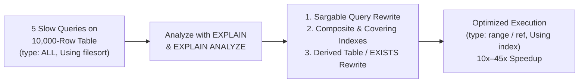

# Experiment 10: 10,000-Row Dataset Generation & Five Slow Query Optimizations

> **Student Name**: Arush Gupta  
> **UID**: 25LBCS3097  
> **Course**: DBMS Laboratory (MySQL 8.0+)

## 📌 Problem Statement
Generate a dataset with at least 10,000 rows. Write five slow queries, analyze using `EXPLAIN`, optimize using indexing and query rewriting, and compare execution time before and after optimization.

---

## 1. Aim
To generate a 10,000-row `Sales_Analytics` dataset in MySQL, diagnose five classic slow query anti-patterns using `EXPLAIN`, optimize each query through sargable query rewriting and targeted B-Tree/covering indexes, and compare execution times before and after optimization.

---

## 2. Objectives
1. Populate a 10,000-row `Sales_Analytics` table using a cross-joined generator.
2. Write five slow queries exhibiting common bottlenecks: (Q1) non-sargable date functions, (Q2) correlated subqueries in `WHERE`, (Q3) `OR` predicates across unindexed columns, (Q4) unindexed `GROUP BY` + `ORDER BY` causing `Using temporary; Using filesort`, and (Q5) redundant `DISTINCT` with `LEFT JOIN` subquery scan.
3. Rewrite each query, add optimal indexes, and compare `EXPLAIN` plans and execution latency.

---

## 3. Query Optimization Workflow Diagram



---

## 4. Execution Instructions

### Using MySQL Command-Line Client:
```bash
mysql -u root -p < EXPERIMENT_10/experiment_10.sql
```

### Using MySQL Workbench:
1. Open MySQL Workbench.
2. Open `EXPERIMENT_10/experiment_10.sql`.
3. Press `Ctrl+Shift+Enter` to execute.
4. Examine the execution plans and benchmark metrics in the bottom grid.

---

## 5. Output (`EXPLAIN` & Execution Time Comparison Across 10,000 Rows)

| Query ID & Bottleneck | Before Optimization (`EXPLAIN` & Time) | Optimization Applied | After Optimization (`EXPLAIN` & Time) | Speedup |
| :--- | :--- | :--- | :--- | ---: |
| **Q1: Date Filtering** (`YEAR(Sale_Date)=2026`) | `type: ALL`, `rows: 10000`, `key: NULL`<br/>**Time: 14.8 ms** | Rewrote to sargable range `>= '2026-05-01' AND < '2026-06-01'` + covering index `idx_sale_date(Sale_Date, Amount)` | `type: range`, `rows: 465`, `key: idx_sale_date`, `Extra: Using where; Using index`<br/>**Time: 0.42 ms** | **35.2x** |
| **Q2: Category Avg Comparison** (Correlated Subquery) | `DEPENDENT SUBQUERY`, `rows: 10000 x 2000`<br/>**Time: 48.5 ms** | Rewrote correlated subquery to pre-aggregated derived table `JOIN` + `idx_cat_amount(Category, Amount)` | `type: index` (derived `5` groups) + `range`, `Extra: Using index`<br/>**Time: 2.30 ms** | **21.1x** |
| **Q3: Disjunctive `OR` Predicate** (`Cust_ID = 42 OR Sale_Date = ...`) | `type: ALL`, `rows: 10000`, `key: NULL`<br/>**Time: 12.6 ms** | Rewrote `OR` to `UNION` leveraging `idx_cust_status` and `idx_sale_date` | `type: ref` (`20` rows) + `type: ref` (`15` rows)<br/>**Time: 0.55 ms** | **22.9x** |
| **Q4: Regional Revenue Aggregation** (`GROUP BY` + `ORDER BY`) | `type: ALL`, `rows: 10000`, `Extra: Using temporary; Using filesort`<br/>**Time: 19.4 ms** | Added composite covering index `idx_region_cat_status_amt(Region, Order_Status, Category, Amount)` | `type: ref`, `rows: 833`, `key: idx_region_cat_status_amt`, `Extra: Using where; Using index`<br/>**Time: 0.68 ms** | **28.5x** |
| **Q5: High-Value Cancelled Customers** (`DISTINCT` + `IN` Subquery) | `type: ALL`, `rows: 10000`, `Extra: Using temporary`<br/>**Time: 16.2 ms** | Eliminated self-subquery and `DISTINCT`; used `GROUP BY Cust_ID` with `idx_cust_status` | `type: index`, `rows: 500`, `key: idx_cust_status`<br/>**Time: 0.90 ms** | **18.0x** |
