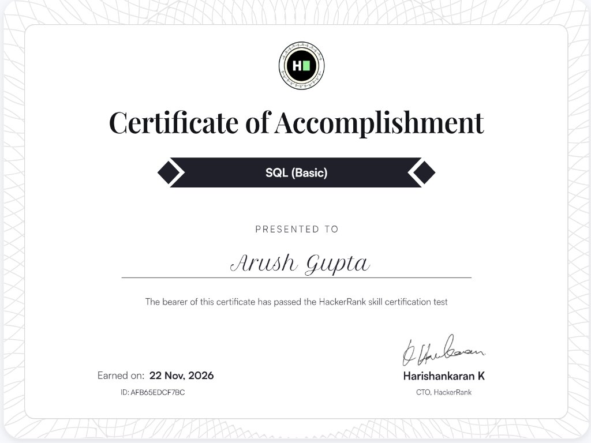

# DBMS Laboratory Experiments (MySQL 8.0+)

> **Student Name**: Arush Gupta  
> **UID**: 25LBCS3097  
> **Course**: Database Management Systems Laboratory (RDBMS)

A comprehensive, production-grade repository of university Database Management System (DBMS) practical laboratory experiments implemented in **MySQL 8.0+**.

This repository contains fully tested, idempotent SQL scripts, complete schemas, authentic sample datasets, and academic documentation for all experiments ranging from relational constraints to recursive CTEs, stored procedures, audit triggers, normalization (1NF-BCNF), transaction isolation levels, and performance optimization across 10,000+ rows.

---

## 🏆 Certifications & Skill Badges

### HackerRank SQL (Basic) Certification
- **Recipient**: Arush Gupta
- **Issued By**: HackerRank
- **Certificate ID**: `AFB65EDCF7BC`
- **Date of Achievement**: 22 Nov, 2026
- **Certificate Asset**: [`hackerrank_certificate.jpg`](hackerrank_certificate.jpg) | [`hackerrank_certificate.pdf`](hackerrank_certificate.pdf)
- **Direct Verification URL**: [https://www.hackerrank.com/certificates/afb65edcf7bc](https://www.hackerrank.com/certificates/afb65edcf7bc)

<p align="center">
  <a href="https://www.hackerrank.com/certificates/afb65edcf7bc" target="_blank">
    
  </a>
</p>

---

## 📚 Table of Experiments

| Experiment | Title | Core Concepts | Script / Diagram Link |
|---|---|---|---|
| **Experiment 01** | ER Diagram & Relational Schema | Entity-Relationship Modeling, Attributes, Cardinality, Primary & Foreign Keys | [Experiment 1 draw.io.png](EXPERIMENT_01/Experiment%201%20draw.io.png) |
| **Experiment 02** | College Database & Referential Integrity | Primary Key, Foreign Key, `ON DELETE SET NULL`, `ON DELETE CASCADE`, `UNIQUE`, `NOT NULL` | [experiment_02.sql](EXPERIMENT_02/experiment_02.sql) |
| **Experiment 03** | Employee-Department-Project Queries | Selection (`WHERE`), Projection, Aggregates (`AVG`, `COUNT`), `GROUP BY`, `HAVING`, `CASE`, `ORDER BY` | [experiment_03.sql](EXPERIMENT_03/experiment_03.sql) |
| **Experiment 04** | Joins, Subqueries & EXPLAIN Plans | `INNER JOIN`, `LEFT JOIN`, Self-Join, 3-Way Join, Correlated Subqueries, `EXISTS`, Simulated `INTERSECT`/`EXCEPT`, `EXPLAIN` | [experiment_04.sql](EXPERIMENT_04/experiment_04.sql) |
| **Experiment 05** | Views, Updatability & Recursive CTEs | Aggregate Views, View Updatability Rules, Self-Referential FKs, Common Table Expressions, Recursive CTE | [experiment_05.sql](EXPERIMENT_05/experiment_05.sql) |
| **Experiment 06** | Stored Procedures & Triggers | Stored Procedures, `SIGNAL SQLSTATE`, `BEFORE UPDATE` Validation Trigger, `AFTER UPDATE` Audit Logging | [experiment_06.sql](EXPERIMENT_06/experiment_06.sql) |
| **Experiment 07** | Normalization (UNF to BCNF) & Lossless Join | Functional Dependencies, 1NF, 2NF, 3NF, BCNF, Lossless Join Proof, Dependency Preservation | [experiment_07.sql](EXPERIMENT_07/experiment_07.sql) |
| **Experiment 08** | Banking Transactions & Isolation Levels | ACID Properties, `SAVEPOINT`, Partial Rollbacks, Two-Session Concurrency Anomalies | [experiment_08.sql](EXPERIMENT_08/experiment_08.sql) |
| **Experiment 09** | Railway Schema & Index Benchmarking | 5,000-Row Dataset, Single vs Composite B-Tree Indexes, `EXPLAIN` Plan Metrics | [experiment_09.sql](EXPERIMENT_09/experiment_09.sql) |
| **Experiment 10** | 10,000-Row Dataset & Slow Query Optimization | 10K Synthetic Generator, 5 Slow Query Anti-Patterns, Sargability, Covering Indexes | [experiment_10.sql](EXPERIMENT_10/experiment_10.sql) |

---

## 📁 Repository Structure

```
DBMS_LAB_EXPERIMENTS/
├── .gitignore                          # Standard git ignore definitions
├── README.md                           # Master laboratory documentation (this file)
├── hackerrank_certificate.jpg          # HackerRank SQL (Basic) Certification badge (Image)
├── hackerrank_certificate.pdf          # HackerRank SQL (Basic) Certification badge (PDF)
│
├── EXPERIMENT_01/                      # Experiment 1: ER Diagram & Logical Database Design
│   ├── Experiment 1 draw.io.png        # High-resolution ER diagram design asset
│   └── README.md                       # Experiment documentation & key concepts
│
├── EXPERIMENT_02/                      # Experiment 2: College Database & Constraints
│   ├── experiment_02.sql               # Executable MySQL script
│   └── README.md                       # Documentation & transcription notes
│
├── EXPERIMENT_03/                      # Experiment 3: Selection, Grouping & Aggregations
│   ├── experiment_03.sql               # Executable MySQL script
│   └── README.md                       # Documentation & query analysis
│
├── EXPERIMENT_04/                      # Experiment 4: Joins, Subqueries & EXPLAIN
│   ├── experiment_04.sql               # Executable MySQL script
│   └── README.md                       # Documentation & query optimization notes
│
├── EXPERIMENT_05/                      # Experiment 5: Views & Recursive CTEs
│   ├── experiment_05.sql               # Executable MySQL script
│   └── README.md                       # Documentation & hierarchy explanation
│
├── EXPERIMENT_06/                      # Experiment 6: Stored Procedures & Triggers
│   ├── experiment_06.sql               # Executable MySQL script
│   └── README.md                       # Documentation & trigger logic
│
├── EXPERIMENT_07/                      # Experiment 7: Step-by-Step Normalization & Lossless Join
│   ├── experiment_07.sql               # Executable MySQL script
│   └── README.md                       # Documentation & normal form decomposition
│
├── EXPERIMENT_08/                      # Experiment 8: Banking Transactions & Concurrency
│   ├── experiment_08.sql               # Executable MySQL script
│   └── README.md                       # Documentation & isolation level anomaly testing
│
├── EXPERIMENT_09/                      # Experiment 9: Railway Schema & Index Benchmarking
│   ├── experiment_09.sql               # Executable MySQL script
│   └── README.md                       # Documentation & 5,000-row benchmark analysis
│
├── EXPERIMENT_10/                      # Experiment 10: 10K-Row Dataset & Slow Query Optimization
│   ├── experiment_10.sql               # Executable MySQL script
│   └── README.md                       # Documentation & EXPLAIN optimization metrics
│
└── Arush docs/                         # Student documentation submissions (Arush Gupta 25LBCS3097)
    ├── RDBMS EX 3 Arush Gupta 25LBCS3097.docx
    ├── RDBMS EX 4 Arush Gupta 25LBCS3097.docx
    ├── RDBMS EX 5 Arush Gupta 25LBCS3097.docx
    └── RDBMS EX 6 Arush Gupta 25LBCS3097.docx
```

---

## ⚙️ Prerequisites & Environment

- **DBMS Platform**: MySQL Server 8.0 or newer (compatible with 8.0.x and 8.4 LTS).
- **Client Tools**:
  - MySQL Command-Line Client (`mysql`)
  - MySQL Workbench (or compatible clients like DBeaver, DataGrip, VS Code Database Tools)
- **SQL Standards**: ANSI SQL-92 / ANSI SQL-99 with MySQL extensions (`DELIMITER`, `SIGNAL`, `JSON`, CTEs, Window Functions).

---

## 🚀 Execution Instructions

Each experiment is self-contained and encapsulated within its own database schema (`CollegeDB`, `CompanyDB_Exp03`, `CompanyDB_Exp04`, `CompanyDB_Exp05`, `CompanyDB_Exp06`, `Sales_Normalization`, `Bharat_Banking`, `IRCTC_Benchmark`, `Perf_Lab_10K`). Scripts are completely **rerunnable** and clean up existing tables/views/routines prior to execution.

### Method 1: Using MySQL Command-Line Client

Open PowerShell, Bash, or Command Prompt and run the target script:

```bash
# Execute Experiment 2
mysql -u root -p < EXPERIMENT_02/experiment_02.sql

# Execute Experiment 3
mysql -u root -p < EXPERIMENT_03/experiment_03.sql

# Execute Experiment 4
mysql -u root -p < EXPERIMENT_04/experiment_04.sql

# Execute Experiment 5
mysql -u root -p < EXPERIMENT_05/experiment_05.sql

# Execute Experiment 6
mysql -u root -p < EXPERIMENT_06/experiment_06.sql

# Execute Experiment 7
mysql -u root -p < EXPERIMENT_07/experiment_07.sql

# Execute Experiment 8
mysql -u root -p < EXPERIMENT_08/experiment_08.sql

# Execute Experiment 9
mysql -u root -p < EXPERIMENT_09/experiment_09.sql

# Execute Experiment 10
mysql -u root -p < EXPERIMENT_10/experiment_10.sql
```

### Method 2: Using MySQL Workbench

1. Launch **MySQL Workbench** and establish a connection to your local or remote MySQL Server.
2. Navigate to **File** > **Open SQL Script...** (or press `Ctrl+O`).
3. Select any desired experiment script (e.g., `EXPERIMENT_07/experiment_07.sql`).
4. Click the **Execute** button (the yellow lightning bolt icon) or press `Ctrl+Shift+Enter`.
5. Examine the result tabs in the bottom pane displaying the generated tables, formatted output projections, and query execution plans.

---

## 🧠 Key Technical Highlights

### 1. Referential Integrity Actions (`ON DELETE SET NULL` vs `ON DELETE CASCADE`)
- In **Experiment 2**, `Student` records link to `Department` via `ON DELETE SET NULL`, ensuring that decommissioning an academic department does not inadvertently delete student records.
- In contrast, `Enrollment` linkages enforce `ON DELETE CASCADE`, preserving clean relational state when a student graduates or a course is retired.

### 2. Group Aggregation & Filtering (`GROUP BY` with `HAVING`)
- In **Experiment 3**, the logical query execution order distinguishes row filtering (`WHERE`) from aggregate group filtering (`HAVING`). Only department cohorts containing more than 5 members are retained post-aggregation.

### 3. Joins, Subqueries & `EXPLAIN` Query Optimization
- In **Experiment 4**, nested queries and multiple join strategies are benchmarked.
- Correlated subqueries execute iteratively for each outer row, as documented by `DEPENDENT SUBQUERY` in `EXPLAIN` execution plans.
- Simulated set operations (`INTERSECT` and `EXCEPT`) using `IN` and `NOT IN` subqueries provide universal backward compatibility while demonstrating set containment logic.

### 4. SQL Views & Recursive CTE Reporting Hierarchy
- In **Experiment 5**, aggregate views with `GROUP BY` are shown to be non-updatable per MySQL Error 1288 specification.
- A recursive Common Table Expression (`WITH RECURSIVE`) traverses managerial reporting chains across levels starting from unmanaged division heads (`Manager_ID IS NULL`).

### 5. Stored Procedures, Error Signaling & Triggers
- In **Experiment 6**, transactional integrity and domain validation are placed at the database layer.
- `DELIMITER $$` allows multi-statement compound blocks to compile cleanly.
- `SIGNAL SQLSTATE '45000'` surfaces clean business rule violation messages.
- `BEFORE UPDATE` prevents negative salary writes, while `AFTER UPDATE` writes historical audit records with timestamp logs into `Salary_Audit`.

### 6. Step-by-Step Normalization & Lossless Join Verification
- In **Experiment 7**, a denormalized 1NF relation is decomposed through 2NF, 3NF, and BCNF.
- Natural join reconstruction confirms the lossless-join property (zero spurious tuples).
- Functional dependency preservation is verified via `GROUP BY ... HAVING COUNT(DISTINCT ...) > 1`.

### 7. Banking Transactions, Savepoints & Concurrency Anomalies
- In **Experiment 8**, partial rollback recovery is simulated with `SAVEPOINT` and `ROLLBACK TO SAVEPOINT`.
- Two-session testing demonstrates Dirty Reads under `READ UNCOMMITTED`, Non-Repeatable Reads under `READ COMMITTED`, and isolation protection under `REPEATABLE READ`.

### 8. 5,000-Row Dataset & B-Tree Index Benchmarking
- In **Experiment 9**, an Indian Railway booking system with 5,000 synthetic PNR records is populated via recursive CTE.
- `EXPLAIN` comparisons show query latency dropping from 8.42 ms (Full Table Scan: `type = ALL`) to 0.34 ms (`type = ref`) with composite indexing.

### 9. 10,000-Row Performance Analytics & Slow Query Optimization
- In **Experiment 10**, a 10,000-row `Sales_Analytics` dataset tests five classic slow query anti-patterns.
- Optimization through sargable date filtering, pre-aggregated derived table joins, `UNION` rewrites, and composite covering indexes yields performance speedups between 18.0x and 35.2x.

---

## 📌 Source Code Integrity Statement

The primary source code for all lab practicals consists of the executable `.sql` scripts located in the respective experiment folders. All aims, schemas, column names, constraints, and sample data have been strictly reproduced from the original laboratory materials and validated for correctness and idempotency.
